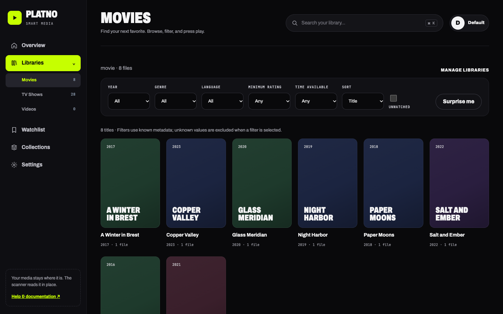
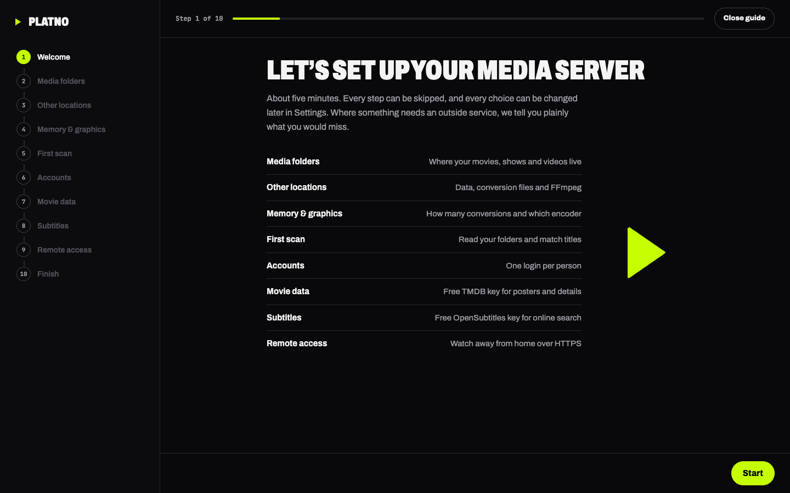

# Platno

**A free, open-source media server for your own hardware, written in Rust. The Plex alternative for people who run a homelab.**

<p align="center"><b><a href="#why-platno">Why Platno</a></b> &nbsp;·&nbsp; <b><a href="#install">Install</a></b> &nbsp;·&nbsp; <b><a href="#more-info">More info</a></b></p>

[](https://github.com/WebLJ-si/Platno/actions/workflows/ci.yml)
[](https://github.com/WebLJ-si/Platno/releases/latest)



## Why Platno

A homelab is supposed to be yours: your hardware, your files, no meter running. Plex has moved in the other direction. Streaming your own library away from home now needs a paid pass ([Plex Pass or a Remote Watch Pass](https://forums.plex.tv/t/remote-streaming-will-be-a-plex-pass-feature/909369)), and your server depends on their account system. That defeats the purpose of running it yourself.

Platno does the same job without a subscription, without an account anywhere, and without a company in the middle. You run one program, your friends and family sign in to *your* server, and nothing leaves your network unless you decide it should.

> **Platno is an open-source project backed by [WebLJ.si](https://weblj.si). Anyone is welcome to take part:** report a problem, suggest a feature, improve the docs or send code. See [Contributing](#contributing).

What you get:

- **Built in Rust for speed and a small footprint.** Platno is one native program of about 20 MB with no Node, Java or Python runtime and no separate database server to run. It starts in a moment and is designed to stay light on modest hardware such as a Raspberry Pi or a NAS. Video conversion is done by FFmpeg, so heavy transcoding still depends on your processor.
- **Nothing to build.** Download a ready-to-run program for Linux, macOS or Windows, install a `.deb`, or start the Docker image. No Rust, no compiler.
- **Works without any account or key.** Series come from TVmaze, movies from the free Wikidata source, and anything unrecognised keeps the name from its file name. Add a free TMDB key later for posters and ratings.
- **You stay in control.** Edit any title's name, details, cover and episodes by hand; edits survive rescans. Media files are read in place and never changed.
- **Plays almost anything.** Direct play when the browser can, FFmpeg conversion (adaptive quality, HDR to SDR) when it cannot. Audio tracks, two subtitles at once, subtitle sync from speech, picture-in-picture.
- **Made for a household.** Owner, administrators and users, profiles with PINs, watchlist and continue watching per profile.
- **Guided first start.** An animated setup guide walks through folders, hardware, accounts, optional API keys and remote access, and says plainly what each skipped step costs.
- **Updates itself when you say so.** One button in Settings checks GitHub, verifies the download and restarts. Nothing is ever sent or installed in the background.
- **Private.** No telemetry in normal builds. The only outside requests are metadata lookups (TVmaze, Wikidata, optionally TMDB and OpenSubtitles) with the title being searched.



---

## Install

Pick one. Every release lists these with checksums: **[Releases](https://github.com/WebLJ-si/Platno/releases/latest)**.

| You have | Do this |
| --- | --- |
| **Windows 10/11** | Download `platno-…-windows-x86_64.zip`, unzip, run `platno.exe`. If SmartScreen warns, choose *More info*, then *Run anyway* (the program is not code-signed yet). |
| **macOS** (Apple silicon or Intel) | `curl -fsSL https://github.com/WebLJ-si/Platno/releases/latest/download/install.sh \| sh`, then `platno`. Or download the `.tar.gz` and run `xattr -d com.apple.quarantine platno`. |
| **Linux** (x86_64 or ARM64, e.g. Raspberry Pi 4/5) | The same one-line installer, or download the `.tar.gz` for your processor. The program is static and runs on any distribution. |
| **Debian or Ubuntu** | `sudo apt install ./platno_…_amd64.deb` (or `arm64`). Installs FFmpeg, creates a service that starts at boot, keeps settings in `/etc/default/platno`. |
| **Docker** | See below. |
| **Synology NAS** | Container Manager with the compose file below, see [docs/synology.md](docs/synology.md). |

Then open **http://127.0.0.1:8787**, create the owner account and follow the guide. Install [FFmpeg](https://ffmpeg.org/download.html) as well (the `.deb` and Docker image already include it) so videos that browsers cannot play directly can be converted.

### Docker

```yaml
services:
  platno:
    image: ghcr.io/weblj-si/platno:latest
    restart: unless-stopped
    ports:
      - "127.0.0.1:8787:8787"
    volumes:
      - platno-data:/data
      - /absolute/path/to/your/media:/media:ro
volumes:
  platno-data:
```

Start it with `docker compose up -d`. The container runs as UID 10001, so your media must be readable by that user. Update with `docker compose pull && docker compose up -d`. Each release page lists every Docker setting. Building the image yourself from this checkout: `docker compose up -d --build` (see [docs/deployment.md](docs/deployment.md)).

### Updating

- **Programs:** Settings → Updates → *Check for updates* → *Install and restart*.
- **Debian/Ubuntu:** install the newer `.deb`.
- **Docker/Synology:** `docker compose pull && docker compose up -d`.

---

## More info

### Documentation

| | |
| --- | --- |
| [User guide](docs/user-guide.md) | Setup, libraries, playback, subtitles, accounts, troubleshooting (also in the app under *Help*) |
| [Interface reference](docs/interface-reference.md) | Every screen and control |
| [Reference](docs/reference.md) | Matching rules, playback details, limits, operation |
| [Deployment](docs/deployment.md), [Synology](docs/synology.md), [Remote access](docs/remote-access.md) | Running it for real |
| [HTTP API](docs/api.md) | Endpoints |
| [Releasing](docs/releasing.md) | How releases, the test branch and updates work |
| [Testing](docs/testing.md), [Validation](docs/validation.md), [Development](docs/development.md) | For contributors |
| [Backlog](TODO.md), [Changelog](CHANGELOG.md) | What is planned and what changed |

### Settings you may want

| Variable | Purpose |
| --- | --- |
| `SMART_MEDIA_HOST` / `SMART_MEDIA_PORT` | Address and port (default `127.0.0.1:8787`; use `0.0.0.0` to reach it from other devices) |
| `SMART_MEDIA_DATA` | Where accounts, library and settings are stored (outside your media folders) |
| `TMDB_TOKEN` | Optional free TMDB Read Access Token for posters and ratings (or add it in the app) |
| `SMART_MEDIA_TRANSCODE_DIR` | Folder for temporary conversion files |
| `SMART_MEDIA_COOKIE_SECURE=1` | Behind an HTTPS reverse proxy |
| `SMART_MEDIA_WIKIDATA=off` | Do not look movies up on Wikidata when no TMDB key is set |
| `SMART_MEDIA_UPDATE_CHECK=off` | Turn the update button off |

The full list is in [.env.example](.env.example). The program does not read `.env` files.

### Branches and testing

`main` is the stable line. The **`test`** branch runs the whole suite and builds every program and a `test` Docker image as downloadable build artifacts, but publishes no release. See [docs/releasing.md](docs/releasing.md).

```sh
python3 scripts/test.py            # Rust, JavaScript and HTTP/FFmpeg tests
python3 scripts/test.py --browser  # plus real Chrome UI tests (needs Node playwright)
```

### Contributing

Platno is built in the open and every kind of help is welcome: bug reports, feature ideas, translations of the documentation, testing on hardware we do not have (Windows, Synology, Raspberry Pi), and code. Open an [issue](https://github.com/WebLJ-si/Platno/issues) to start a conversation, or a pull request against the `test` branch. See [CONTRIBUTING.md](CONTRIBUTING.md) for how to run the tests.

### Acknowledgements and notices

Series metadata comes from [TVmaze](https://www.tvmaze.com/api) (CC BY-SA 4.0), free movie data from [Wikidata](https://www.wikidata.org) (CC0), optional movie data from [TMDB](https://www.themoviedb.org), and optional subtitle search from [OpenSubtitles](https://www.opensubtitles.com).

*This product uses the TMDB API but is not endorsed or certified by TMDB.* Platno is an independent project and is not affiliated with Plex, Jellyfin, TVmaze, TMDB, Wikidata or OpenSubtitles. Video conversion uses [FFmpeg](https://ffmpeg.org), which has its own licence. Each person uses their own provider keys; Platno never collects them.

Platno is backed by [WebLJ.si](https://weblj.si). A licence for Platno itself has not been chosen yet. Until one is added to the repository, the usual copyright rules apply to the code.
